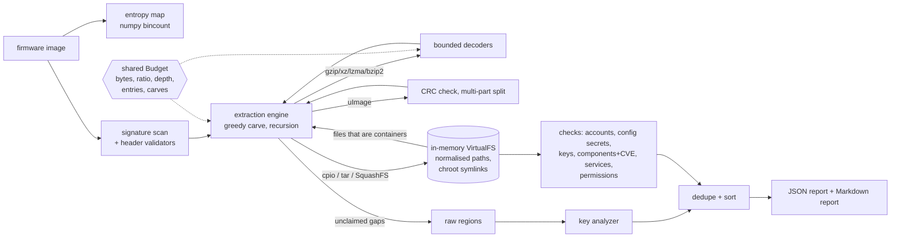

# fwaudit

Offline firmware image auditor for embedded Linux / IoT devices. Give it a flash dump or
an update file; it identifies the containers inside, extracts them **in memory** under hard
safety limits, maps entropy, and audits every filesystem it finds for the weaknesses that
keep showing up in IoT security advisories: hardcoded and default credentials, shipped
private keys and expired certificates, vulnerable BusyBox / OpenSSL / Dropbear / dnsmasq
builds, telnet and default web logins, and world-writable setuid binaries. Output is a
precise JSON report (with a JSON Schema) and a Markdown report.

It is a lab and portfolio tool: everything is tested against synthetic firmware images that
the repository builds itself, with known planted findings as ground truth. See
[Limitations](#limitations) before pointing it at anything that matters.

## Who it is for

* Security engineers doing a first-pass review of a device image before deeper reverse
  engineering (the report says where to look and what is missing).
* Product teams that want a CI gate on their own firmware builds
  (`fwaudit scan image.bin --fail-on high` exits 1).
* People learning firmware analysis who want to see how carving, decompression-bomb
  defence and credential checks work, in about 6,700 lines of typed Python.

## What it does

| Stage | Details |
|---|---|
| Identification | Signature scan with structural validation: uImage (header CRC), gzip, xz, LZMA-alone, bzip2, cpio (newc/crc/odc), tar (checksum), SquashFS 4.0, plus informational ELF / FDT and flagged-unsupported CramFS and big-endian SquashFS |
| Extraction | Recursive greedy carve; uImage multi-file payloads; bounded decompression; cpio/tar/SquashFS mounted into an in-memory virtual filesystem; containers inside files (e.g. `defaults.tar.gz`) explored too |
| Safety | Path traversal (`..`, absolute names, writes through symlinks) rejected and reported; decompression bombs stopped by per-stream, global and ratio limits; nesting depth, entry and carve limits; optional `--extract-to` never creates symlinks or device nodes |
| Entropy | Vectorised per-block Shannon entropy, region classification, unexplained high-entropy regions reported as possibly encrypted |
| Credentials | `/etc/passwd` + `/etc/shadow` (empty passwords, hashes in passwd, DES/MD5 crypt, UID-0 backdoors, world-readable shadow, default passwords cracked offline with pure-Python md5/sha256/sha512-crypt), secrets in configs and scripts (key=value, JSON/YAML, UCI, URLs, `chpasswd`) |
| Keys and certificates | PEM private keys (RSA/EC/DSA/PKCS#8/OpenSSH, encrypted or not), dropbear binary host keys, PEM/DER certificates with expiry relative to a reference time, weak key sizes and SHA-1/MD5 signatures, key reuse across locations; also in raw unclaimed regions such as NVRAM |
| Components | BusyBox, OpenSSL, Dropbear and dnsmasq versions from ELF binaries, matched against a pinned offline CVE subset (20 CVEs, integrity-checked, cross-checked against NVD) |
| Services | telnetd from init scripts / inittab / inetd / xinetd (escalated to CRITICAL for `-l /bin/sh`), default web credentials in BusyBox httpd.conf / htpasswd / htdigest, anonymous FTP, default SNMP communities, SSH root password login |
| Permissions | World-writable setuid/setgid files, setuid-root inventory, world-writable files in system directories, world-writable directories without the sticky bit |

30 rules in total (`fwaudit rules`). Recovered secrets are masked in reports unless you
pass `--show-secrets`.

## Architecture



Nothing is written to the host while auditing. `docs/ARCHITECTURE.md` covers the
algorithms and their complexity; `docs/THREAT_MODEL.md` covers what the tool defends
against.

## Quickstart

Requires [uv](https://docs.astral.sh/uv/) and Python 3.12.

```sh
make install                       # uv sync --frozen
make check                         # format + lint + mypy --strict + tests + coverage gate
make demo                          # offline end-to-end demo on examples/firmware

uv run fwaudit scan examples/firmware/dev-0023-flash-squashfs-xz.bin \
    --reference-time 2026-01-01 --json report.json --markdown report.md
uv run fwaudit identify image.bin  # signatures only
uv run fwaudit entropy image.bin   # entropy map
uv run fwaudit synth out/ --seeds 0-9 --split holdout --hostile   # build test images
```

Library use:

```python
from fwaudit import audit_file

result = audit_file("firmware.bin")
for f in result.findings:
    print(f.severity.name, f.rule_id, f.path, f.detail)
```

`scan` exits 0, or 1 when `--fail-on SEVERITY` is given and a finding reaches it, or 2 on
an input/IO error. Useful limits: `--max-depth`, `--max-total-mb`, `--max-ratio`.

## Demo output

From `make demo` (abridged; the full run also prints the entropy region table and the
signature list):

```
==== 3. scan: extract + audit, write JSON and Markdown reports, materialise the rootfs ====
fwaudit 0.1.0: dev-0023-flash-squashfs-xz.bin (262144 bytes, sha256 ed6335045acb7e43...)
  filesystems: 2, extraction nodes: 7, extracted bytes: 104363
  entropy: ██      ███     ▁               ████████████████
  findings: 25
  [CRITICAL] FWA-CMP-002  /bin/busybox  busybox 1.36.1 is affected by 1 CVE(s) in the offline subset: CVE-2022-48174
  [CRITICAL] FWA-CMP-002  /usr/sbin/dropbear  dropbear 2016.72 is affected by 5 CVE(s) in the offline subset: CVE-2016-7406, CVE-2016-7407, CVE-2017-9078, CVE-2020-36254, CVE-2018-15599
  [CRITICAL] FWA-CRED-001 /etc/passwd  account 'root' can log in without a password
  [CRITICAL] FWA-SVC-002  /www/.htpasswd  web user 'admin' has default password ad*** (len 5) (apr1) on line 1
  [HIGH    ] FWA-CMP-002  /usr/sbin/dnsmasq  dnsmasq 2.80 is affected by 1 CVE(s) in the offline subset: CVE-2020-25681
  [HIGH    ] FWA-CRED-006 /etc/config/cloud.conf  kv credential 'cloud_api_key' = 3y*** (len 12) on line 3
  [HIGH    ] FWA-CRED-006 /etc/config/admin.conf  kv credential 'admin_password' = dk*** (len 12) on line 2
  [HIGH    ] FWA-KEY-001  @0x2004b  PRIVATE KEY (unencrypted, ec-secp256r1 256 bits)
  [HIGH    ] FWA-KEY-001  /etc/dropbear/dropbear_rsa_host_key  dropbear host private key (rsa, 1024 bits) in the image
  [HIGH    ] FWA-KEY-001  /etc/ssl/private/server.key  PRIVATE KEY (unencrypted, ec-secp256r1 256 bits)
  [MEDIUM  ] FWA-KEY-002  /etc/ssl/certs/cloud.pem  certificate CN=cloud.example.invalid expired on 2020-01-01 (2192 days before the reference time)
  ...
  [INFO    ] FWA-EXT-006  @0x30c38  62408 bytes at 0x30c38 have mean entropy 7.95 bits/byte and match no known container
  ...

==== 4. ground truth for this image vs. the report ====
planted: 25  reported: 25  missed: 0  unexpected: 0

==== 5. hostile inputs: traversal, bombs, nesting, tampered header ====
hostile-cpio-traversal.bin       extracted     522 bytes -> FWA-EXT-001
hostile-gzip-bomb.bin            extracted       0 bytes -> FWA-EXT-002
hostile-nesting.bin              extracted    1357 bytes -> FWA-EXT-003
hostile-squashfs-traversal.bin   extracted      10 bytes -> FWA-EXT-001
hostile-tar-traversal.bin        extracted      86 bytes -> FWA-EXT-001
hostile-uimage-header-crc.bin    extracted   14000 bytes -> FWA-EXT-004
hostile-xz-bomb.bin              extracted       0 bytes -> FWA-EXT-002
traversal target /tmp/fwaudit-pwned was not created

==== 6. CI gating: --fail-on high returns exit status 1 when HIGH+ findings exist ====
exit status: 1
```

The `/etc/config/admin.conf` secret lives in a `tar.gz` inside the SquashFS; the
`@0x2004b` key sits in a raw NVRAM partition no container claims; the high-entropy region
is a random blob standing in for an encrypted partition.

## Evaluation

Ground truth comes from `src/fwaudit/synth/firmware.py`: a seeded generator builds a small
embedded-Linux rootfs, plants a random subset of about 25 weakness types (plus negative
controls: strong passwords, commented-out telnetd, password-policy keys, `${VAR}`
placeholders, `anonymous_enable=NO`, unique SNMP communities, `dropbear -s -g`, a doc file
that mentions an old OpenSSL), and packs it into one of five layouts (uImage multi-file
with gzip cpio, kernel + LZMA ramdisk uImages, flash with gzip or xz SquashFS + NVRAM +
optional random blob, xz-compressed tar update). Expected CVE sets are written by hand from
the NVD ranges, not computed by fwaudit's matcher. A finding matches when rule, path and
location class (image / extracted / nested) agree, and CVE findings must also carry
exactly the expected CVE ids.

Two splits: **dev** (the forms used while writing detectors) and **holdout**, which adds
surface forms that were not used for tuning (CRLF line endings, JSON configs, xinetd telnet,
DER certificates, vendor directories, tab-indented UCI, `rc.local` telnet,
`/etc/httpd/httpd.conf`).

| Run | Command | Images | Planted | Precision | Recall |
|---|---|---:|---:|---:|---:|
| holdout v1, **first run, before any fix** | `scripts/evaluate.py --split holdout --seeds 0-99` (commit `90bc2b8`) | 100 | 1831 | 1.000 | **0.985** |
| holdout after fixing the two missed forms | `make eval` (`--split holdout --seeds 100-199`) | 100 | 1838 | 1.000 | 1.000 |
| dev (tuning split, not a generalisation measure) | `make eval` (`--split dev --seeds 0-99`) | 100 | 1865 | 1.000 | 1.000 |
| hostile extraction samples | `make eval` (`--hostile`) | 7 | 10 | 1.000 | 1.000 |

The first held-out run missed 27 findings, all in two forms the detectors had never seen:
secrets in JSON configs (`"admin_password": "..."`, 16 misses) and telnet enabled through an
xinetd `service` block (11 misses). Both were fixed (commit `ea8a053`) and the post-fix
number is reported on fresh seeds, but those two forms are no longer unseen, so **the
honest generalisation figure is the 0.985 from the first run**. Raw results, including
every miss, are in `results/eval-*.json`.

What these numbers do and do not mean: the generator and the detectors were written by the
same author, so a perfect score shows that the detectors cover every form the generator
can emit and raise no false positives on its negative controls. It says nothing about recall
on real vendor firmware, which uses many more layouts and file conventions.

## Benchmarks

`make bench` (`scripts/bench.py`, median of 5 runs; Apple-silicon laptop shared with
other build jobs, so treat as order-of-magnitude):

| Measurement | Result |
|---|---|
| Entropy map, 64 MiB mixed buffer | 189 MiB/s |
| Signature scan, 64 MiB mixed buffer | 92 MiB/s |
| Full audit, 35-256 KiB synthetic images (5 layouts) | 60-79 ms each |
| 64 MiB gzip bomb (66 KB input): time / peak traced allocation | 5 ms / 25.0 MiB |
| 64 MiB xz bomb (10 KB input): time / peak traced allocation | 8 ms / 16.1 MiB |

The bomb rows matter more than speed: before commit `deff284` the same gzip bomb peaked at
141 MiB because one decoder call could inflate up to the per-stream cap before the ratio
check ran. Each decoder call is now capped at the ratio allowance for the input fed so
far, and `tests/test_compression.py` asserts the bound for all five codecs.

Test suite: 155 tests (unit, integration, Hypothesis property tests that feed random and
mutated images, golden report, ground truth, hostile samples); branch coverage 96.3-96.5%
across runs (`make coverage`, gate at 90%; the range comes from Hypothesis drawing
different inputs each run).

## Design decisions

Full list with trade-offs in [DECISIONS.md](DECISIONS.md). The main ones:

* **In-memory virtual filesystem instead of unpacking to disk.** Audit-time extraction can
  never write outside a root or follow a planted symlink, because there is no disk.
  Symlinks resolve with chroot semantics and bounded hops.
* **Every decoder draws from one shared budget**, so limits hold across nesting (a bomb
  split over ten nested gzip layers still hits the global cap).
* **SquashFS via the PySquashfsImage library** (pure Python, LGPL), wrapped with bounded
  decompressors and superblock sanity checks; `unsquashfs` is not required. gzip and xz
  SquashFS only; LZO / LZ4 / ZSTD are reported as unsupported rather than silently skipped.
* **Pure-Python crypt(3)** (md5, apr1, sha256, sha512 with a rounds cap), because the
  stdlib `crypt` module is gone in Python 3.13. Used only to test hashes against a short
  public list of factory defaults.
* **Pinned offline CVE subset** with a SHA-256 integrity pin compiled into the code, and a
  network script (`make verify-cvedb`) that re-checks every score and range against NVD.
* **Deterministic output**: fixed reference time for certificate expiry, sorted findings,
  stable finding ids, no wall-clock values in reports; this makes the golden test possible.

## Limitations

* **Evaluated only on synthetic images.** No real vendor firmware is bundled (licensing),
  and real images use layouts, filesystems and conventions this tool does not know.
* **Formats:** no JFFS2, UBI/UBIFS, YAFFS2, CramFS, ext2/4, ISO, ZIP/7z, LZO/LZ4/ZSTD
  (including SquashFS with those compressors), legacy or big-endian SquashFS, Android or
  vendor-specific headers (TRX, Seama, DLOB...). Unsupported but recognised containers are
  reported (`FWA-EXT-005`) so the gap is visible.
* **Encrypted firmware** is only flagged as unexplained high entropy; nothing is decrypted.
* **Component detection** covers four components and relies on version strings inside ELF
  binaries; stripped or patched builds and vendor backports are misreported. The CVE
  subset has 20 entries and is not a vulnerability database: absence of a CVE means
  nothing.
* **Credential checks** use a 28-pair default list; DES crypt hashes are flagged as weak
  but not cracked; bcrypt/yescrypt are never cracked. Config-secret detection is
  pattern-based and will miss unusual shapes (as the first held-out run showed) and can
  flag benign assignments.
* **Service checks** read static configuration only; they cannot tell whether a script
  is actually invoked at boot.
* **Entropy-based "encrypted" verdicts** cannot distinguish encryption from compression
  formats fwaudit does not know.
* Performance on large images is unmeasured: the benchmarks use synthetic images of a few
  hundred KiB, and the SquashFS reader and all extraction are pure Python held in memory
  (bounded by the limits, default 768 MiB of extracted data).

## Roadmap

* UBI/UBIFS and JFFS2 readers (the most common gaps on NAND/NOR devices).
* LZ4 / ZSTD / LZO via optional extras.
* Larger component catalogue (lighttpd, uhttpd, curl, libupnp, Linux kernel) with an
  OSV-format CVE import instead of a hand-curated file.
* SARIF output for code-scanning dashboards.
* A small corpus of permissively licensed open-source firmware builds (e.g. OpenWrt
  release images fetched by checksum) as a second, non-synthetic evaluation set.

## Repository layout

```
src/fwaudit/       formats/ extract/ audit/ report/ synth/  (library + CLI)
tests/             unit, integration, property, golden, ground truth
scripts/           evaluate.py, bench.py, demo.sh, verify_cvedb.py, pin_cvedb.py, update_golden.py
examples/firmware/ bundled synthetic images + ground truth (regenerate: make fixtures)
results/           committed evaluation and benchmark output
docs/              ARCHITECTURE.md, THREAT_MODEL.md
```

Data sources and licences: [DATA.md](DATA.md). Licence: MIT.
