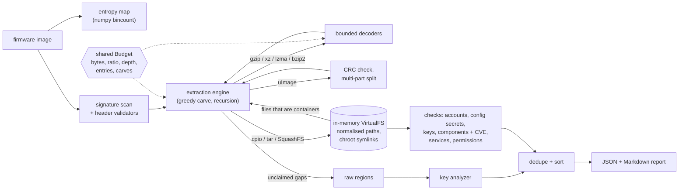

# fwaudit

Offline firmware image auditor for embedded Linux / IoT devices: it identifies the
containers in a flash dump or update file, extracts them **in memory** under hard safety
limits, and audits every filesystem it finds for hardcoded credentials, shipped private
keys, vulnerable components, unsafe services and dangerous permissions.

[](https://github.com/SlateGitOrg/fwaudit/actions/workflows/ci.yml)

## Why

IoT security advisories keep reporting the same handful of mistakes: an empty root
password, a factory-default web login, a private key baked into every unit, a BusyBox or
Dropbear build that is years out of date, telnetd started from an init script. Finding
them usually means unpacking the vendor image to disk with a carving tool and grepping
through the result, which is also where unpacking attacker-controlled archives goes wrong:
`../` member names, writes through planted symlinks and decompression bombs all target the
analyst's machine. fwaudit does that first-pass review without writing anything to disk,
treats every byte of the image as hostile, and produces a deterministic JSON report that a
CI job can gate on (`fwaudit scan image.bin --fail-on high` exits 1).

## Features

- **Identification**: signature scan with structural validation for uImage (header CRC),
  gzip, xz, LZMA-alone, bzip2, cpio (newc/crc/odc), tar (checksum) and SquashFS 4.0, plus
  informational ELF / FDT hits and flagged-unsupported CramFS and big-endian SquashFS.
- **Safe extraction**: recursive greedy carve, uImage multi-file payloads, bounded
  decompression, and cpio/tar/SquashFS mounted into an in-memory virtual filesystem.
  Containers inside files (e.g. `defaults.tar.gz` in the rootfs) are explored too.
- **Unpacker attack defence**: path traversal (`..`, absolute names, writes through
  symlinks) is rejected and reported; decompression bombs are stopped by per-stream,
  global and ratio limits; nesting depth, entry and carve counts are capped. The optional
  `--extract-to` never creates symlinks or device nodes.
- **Entropy map**: vectorised per-block Shannon entropy with region classification;
  unexplained high-entropy regions are reported as possibly encrypted.
- **Credentials**: `/etc/passwd` + `/etc/shadow` (empty passwords, hashes in passwd,
  DES/MD5 crypt, UID-0 backdoors, world-readable shadow, factory-default passwords cracked
  offline with pure-Python md5/apr1/sha256/sha512-crypt), and secrets in configs and
  scripts (key=value, JSON/YAML, UCI, URLs, `chpasswd`).
- **Keys and certificates**: PEM private keys (RSA/EC/DSA/PKCS#8/OpenSSH, encrypted or
  not), Dropbear binary host keys, PEM/DER certificates with expiry relative to a
  reference time, weak key sizes, SHA-1/MD5 signatures and key reuse across locations,
  including keys sitting in raw unclaimed regions such as NVRAM.
- **Components**: BusyBox, OpenSSL, Dropbear and dnsmasq versions read from ELF binaries
  and matched against a pinned offline CVE subset (20 CVEs, SHA-256 integrity pin,
  cross-checked against NVD by `make verify-cvedb`).
- **Services**: telnetd from init scripts / inittab / inetd / xinetd (CRITICAL for
  `-l /bin/sh`), default web credentials in BusyBox `httpd.conf` / htpasswd / htdigest,
  anonymous FTP, default SNMP communities, SSH root password login.
- **Permissions**: world-writable setuid/setgid files, setuid-root inventory,
  world-writable files in system directories, world-writable directories without the
  sticky bit.
- **Reports**: JSON (`fwaudit-report/1`, with a JSON Schema) and Markdown. 30 rules in
  total (`fwaudit rules`); recovered secrets are masked unless you pass `--show-secrets`.

## Architecture



`signatures.scan` finds and validates every container header; the extraction engine
carves left to right, decodes streams through decoders that all draw from one shared
`Budget`, and mounts archives and filesystems into a `VirtualFS` that lives only in
memory. The checks then run over each mounted filesystem, the key analyzer also scans the
bytes no container claimed, and the findings are de-duplicated and sorted into the
reports. Nothing is written to the host while auditing.
[docs/ARCHITECTURE.md](docs/ARCHITECTURE.md) covers each stage's algorithm and cost;
[docs/THREAT_MODEL.md](docs/THREAT_MODEL.md) covers what the tool defends against.

## Quick start

Prerequisites: [uv](https://docs.astral.sh/uv/) (CI pins 0.11.28; 0.7 also works), GNU
make, and Python 3.12 installed through uv. CI runs on Ubuntu and macOS.

```sh
uv python install 3.12   # the uv-managed build CI uses (see Limitations for why)
make install             # uv sync --frozen: creates .venv from uv.lock
make demo                # offline end-to-end demo on examples/firmware
make check               # ruff format + lint, mypy --strict, tests, 90 % coverage gate
```

Audit a bundled image and write both reports:

```sh
uv run fwaudit scan examples/firmware/dev-0023-flash-squashfs-xz.bin \
    --reference-time 2026-01-01 --json report.json --markdown report.md
```

Other commands:

```sh
uv run fwaudit identify examples/firmware/hostile-uimage-header-crc.bin   # signatures only
uv run fwaudit entropy examples/firmware/hostile-gzip-bomb.bin            # entropy map
uv run fwaudit synth out/ --seeds 0-9 --split holdout --hostile           # build test images
uv run fwaudit rules                                                      # rule catalogue
```

## Usage

`scan` prints a summary and every finding (abridged):

```
$ uv run fwaudit scan examples/firmware/dev-0023-flash-squashfs-xz.bin --reference-time 2026-01-01
fwaudit 0.1.0: dev-0023-flash-squashfs-xz.bin (262144 bytes, sha256 f3d1466af17e910f...)
  filesystems: 2, extraction nodes: 7, extracted bytes: 104363
  entropy: ██      ███     ▁               ████████████████
  findings: 25
  [CRITICAL] FWA-CMP-002  /bin/busybox  busybox 1.36.1 is affected by 1 CVE(s) in the offline subset: CVE-2022-48174
  [CRITICAL] FWA-CMP-002  /usr/sbin/dropbear  dropbear 2016.72 is affected by 5 CVE(s) in the offline subset: CVE-2016-7406, CVE-2016-7407, CVE-2017-9078, CVE-2020-36254, CVE-2018-15599
  [CRITICAL] FWA-CRED-001 /etc/passwd  account 'root' can log in without a password
  [CRITICAL] FWA-SVC-002  /www/.htpasswd  web user 'admin' has default password ad*** (len 5) (apr1) on line 1
  [HIGH    ] FWA-CMP-002  /usr/sbin/dnsmasq  dnsmasq 2.80 is affected by 1 CVE(s) in the offline subset: CVE-2020-25681
  [HIGH    ] FWA-CRED-006 /etc/config/cloud.conf  kv credential 'cloud_api_key' = 3y*** (len 12) on line 3
  [HIGH    ] FWA-CRED-006 /etc/config/admin.conf  kv credential 'admin_password' = dk*** (len 12) on line 2
  [HIGH    ] FWA-KEY-001  @0x2004b  PRIVATE KEY (unencrypted, ec-secp256r1 256 bits)
  [HIGH    ] FWA-KEY-001  /etc/dropbear/dropbear_rsa_host_key  dropbear host private key (rsa, 1024 bits) in the image
  [HIGH    ] FWA-KEY-001  /etc/ssl/private/server.key  PRIVATE KEY (unencrypted, ec-secp256r1 256 bits)
  [MEDIUM  ] FWA-KEY-002  /etc/ssl/certs/cloud.pem  certificate CN=cloud.example.invalid expired on 2020-01-01 (2192 days before the reference time)
  ...
  [INFO    ] FWA-EXT-006  @0x30c38  62408 bytes at 0x30c38 have mean entropy 7.95 bits/byte and match no known container
  ...
```

The `/etc/config/admin.conf` secret lives in a `tar.gz` inside the SquashFS; the
`@0x2004b` key sits in a raw NVRAM partition no container claims; the high-entropy region
is a random blob standing in for an encrypted partition.

Each JSON finding carries a stable id, the filesystem it came from and structured
evidence:

```json
{
  "category": "component",
  "detail": "busybox 1.36.1 is affected by 1 CVE(s) in the offline subset: CVE-2022-48174",
  "evidence": {
    "component": "busybox",
    "cves": [{"affected": ">= 0, <= 1.36.1", "cvss": 9.8, "id": "CVE-2022-48174", "summary": "ash stack overflow in arithmetic evaluation, may lead to code execution"}],
    "paths": ["/bin/busybox"],
    "version": "1.36.1"
  },
  "filesystem": "image/squashfs@0x10000",
  "id": "F-c29e9e0ec764",
  "offset": null,
  "path": "/bin/busybox",
  "remediation": "Upgrade the component to a fixed release.",
  "rule_id": "FWA-CMP-002",
  "severity": "critical",
  "title": "Component version affected by known CVEs (offline subset)"
}
```

`make demo` also checks the report against the image's ground truth and runs the hostile
samples:

```
==== 4. ground truth for this image vs. the report ====
planted: 25  reported: 25  missed: 0  unexpected: 0

==== 5. hostile inputs: traversal, bombs, nesting, tampered header ====
hostile-cpio-traversal.bin       extracted     522 bytes -> FWA-EXT-001
hostile-gzip-bomb.bin            extracted       0 bytes -> FWA-EXT-002
hostile-nesting.bin              extracted    1347 bytes -> FWA-EXT-003
hostile-squashfs-traversal.bin   extracted      10 bytes -> FWA-EXT-001
hostile-tar-traversal.bin        extracted      86 bytes -> FWA-EXT-001
hostile-uimage-header-crc.bin    extracted   14000 bytes -> FWA-EXT-004
hostile-xz-bomb.bin              extracted       0 bytes -> FWA-EXT-002
traversal target /tmp/fwaudit-pwned was not created

==== 6. CI gating: --fail-on high returns exit status 1 when HIGH+ findings exist ====
exit status: 1
```

`scan` exits 0, or 1 when `--fail-on SEVERITY` is given and a finding reaches it, or 2 on
an input/IO error. Useful limits: `--max-depth`, `--max-total-mb`, `--max-ratio`.

As a library:

```python
from fwaudit import audit_file

result = audit_file("examples/firmware/hostile-tar-traversal.bin")
for f in result.findings:
    print(f.severity.name, f.rule_id, f.path, f.detail)
```

```
HIGH FWA-EXT-001 None member '../../../tmp/fwaudit-pwned' rejected: parent-directory component '..' in member name
HIGH FWA-EXT-001 None member 'etclink/cron.d/evil' rejected: member would be written through symlink '/etclink'
```

## How it works

Full list of decisions with their trade-offs in [DECISIONS.md](DECISIONS.md). The main
ones:

- **In-memory virtual filesystem instead of unpacking to disk.** Audit-time extraction
  can never write outside a root or follow a planted symlink, because there is no disk.
  Symlinks resolve with chroot semantics and a 40-hop cap.
- **Every decoder draws from one shared budget**, so limits hold across nesting: a bomb
  split over ten nested gzip layers still hits the global cap. Each decoder call is also
  capped at the ratio allowance for the input fed so far, so peak memory tracks the input,
  not the per-stream cap.
- **SquashFS via PySquashfsImage** (pure Python, LGPL), wrapped with bounded
  decompressors and superblock sanity checks; `unsquashfs` is not required. gzip and xz
  SquashFS only; LZO / LZ4 / ZSTD are reported as unsupported rather than silently
  skipped.
- **Pure-Python crypt(3)** (md5, apr1, sha256, sha512 with a rounds cap), because the
  stdlib `crypt` module is gone in Python 3.13. It is used only to test hashes against a
  short public list of factory defaults.
- **Non-backtracking PEM scanner** instead of a lazy `BEGIN(.{1,65536}?)END` regex, which
  measured 34 s on 1 MiB of unmatched BEGIN headers: BEGIN headers are found in one pass,
  END markers indexed once and paired by binary search, and the scanner is
  property-tested to return the same blocks as the reference pattern.
- **Pinned offline CVE subset** with a SHA-256 integrity pin compiled into the code, and a
  network script (`make verify-cvedb`) that re-checks every score and range against NVD.
- **Deterministic output**: fixed reference time for certificate expiry, sorted findings,
  stable finding ids and no wall-clock values in reports, which is what makes the golden
  test possible. The synthetic images are deterministic too, down to the gzip header
  (zlib otherwise stamps its build OS into it), so the bundled fixtures are byte-identical
  on Linux and macOS.

### Evaluation

Ground truth comes from `src/fwaudit/synth/firmware.py`: a seeded generator builds a small
embedded-Linux rootfs, plants a random subset of about 25 weakness types (plus negative
controls: strong passwords, commented-out telnetd, password-policy keys, `${VAR}`
placeholders, `anonymous_enable=NO`, unique SNMP communities, `dropbear -s -g`, a doc file
that mentions an old OpenSSL), and packs it into one of five layouts (uImage multi-file
with gzip cpio, kernel + LZMA ramdisk uImages, flash with gzip or xz SquashFS + NVRAM +
optional random blob, xz-compressed tar update). Expected CVE sets are written by hand from
the NVD ranges, not computed by fwaudit's matcher. A finding matches when rule, path and
location class (image / extracted / nested) agree, and CVE findings must also carry
exactly the expected CVE ids.

There are two splits: **dev** (the forms used while writing detectors) and **holdout**,
which adds surface forms that were not used for tuning (CRLF line endings, JSON configs,
xinetd telnet, DER certificates, vendor directories, tab-indented UCI, `rc.local` telnet,
`/etc/httpd/httpd.conf`).

| Run | Command | Images | Planted | Precision | Recall |
|---|---|---:|---:|---:|---:|
| holdout v1, **first run, before any fix** | `scripts/evaluate.py --split holdout --seeds 0-99` (commit `90bc2b8`) | 100 | 1831 | 1.000 | **0.985** |
| holdout after fixing the two missed forms | `make eval` (`--split holdout --seeds 100-199`) | 100 | 1838 | 1.000 | 1.000 |
| dev (tuning split, not a generalisation measure) | `make eval` (`--split dev --seeds 0-99`) | 100 | 1865 | 1.000 | 1.000 |
| hostile extraction samples | `make eval` (`--hostile`) | 7 | 10 | 1.000 | 1.000 |

The first held-out run missed 27 findings, all in two forms the detectors had never seen:
secrets in JSON configs (`"admin_password": "..."`, 16 misses) and telnet enabled through an
xinetd `service` block (11 misses). Both were fixed (commit `ea8a053`) and the post-fix
number is reported on fresh seeds, but those two forms are no longer unseen, so **the
honest generalisation figure is the 0.985 from the first run**. Raw results, including
every miss, are in `results/eval-*.json`.

What these numbers do and do not mean: the generator and the detectors come from the same
hands, so a perfect score shows that the detectors cover every form the generator can emit
and raise no false positives on its negative controls. It says nothing about recall on
real vendor firmware, which uses many more layouts and file conventions.

### Benchmarks

`make bench` (`scripts/bench.py`, median of 5 runs, Apple-silicon laptop, Python 3.12.11;
treat as order-of-magnitude, results in `results/bench.json`):

| Measurement | Result |
|---|---|
| Entropy map, 64 MiB mixed buffer | 287 MiB/s |
| Signature scan, 64 MiB mixed buffer | 155 MiB/s |
| Full audit, 35-256 KiB synthetic images (5 layouts) | 42-59 ms each |
| 64 MiB gzip bomb (66 KB input): time / peak traced allocation | 7.6 ms / 25.0 MiB |
| 64 MiB xz bomb (10 KB input): time / peak traced allocation | 13.9 ms / 16.1 MiB |

The bomb rows matter more than speed: before commit `deff284` the same gzip bomb peaked at
141 MiB because one decoder call could inflate up to the per-stream cap before the ratio
check ran. `tests/test_compression.py` asserts the bound for all five codecs.

## Testing

```sh
make test       # pytest: 163 tests
make coverage   # same tests with branch coverage, fails below 90 %
make check      # format-check + lint + mypy --strict + coverage (what CI runs)
make eval       # precision/recall against synthetic ground truth (CI runs this too)
```

The suite covers each format reader and the signature validators, bounded decompression
for every codec, path normalisation and the virtual filesystem, every check against
targeted inputs, the crypt(3) implementations against OpenSSL-generated vectors, the PEM
scanner's equivalence with the reference regex and its linear-time behaviour, the CLI and
`--extract-to` hardening, Hypothesis property tests that feed random and mutated images
(`tests/test_fuzz.py`), exact ground-truth matching on generated samples, a byte-identical
golden JSON report (`tests/test_golden.py`), and a check that the bundled
`examples/firmware` images are exactly what the generator produces
(`tests/test_fixtures.py`). Branch coverage is about 96 % (96.4-96.5 % on recent runs; it moves
by a few tenths because Hypothesis draws different inputs each run).

After an intentional output change, regenerate the fixtures and golden report with
`make fixtures` and `make golden`.

## Project layout

```
src/fwaudit/       formats/ extract/ audit/ report/ synth/  (library + CLI)
tests/             unit, integration, property, golden, ground truth
scripts/           evaluate.py, bench.py, demo.sh, verify_cvedb.py, pin_cvedb.py, update_golden.py
examples/firmware/ bundled synthetic images + ground truth (regenerate: make fixtures)
results/           committed evaluation and benchmark output
docs/              ARCHITECTURE.md, THREAT_MODEL.md
```

## Limitations

- **Evaluated only on synthetic images.** No real vendor firmware is bundled (licensing),
  and real images use layouts, filesystems and conventions this tool does not know.
- **Formats:** no JFFS2, UBI/UBIFS, YAFFS2, CramFS, ext2/4, ISO, ZIP/7z, LZO/LZ4/ZSTD
  (including SquashFS with those compressors), legacy or big-endian SquashFS, Android or
  vendor-specific headers (TRX, Seama, DLOB...). Unsupported but recognised containers are
  reported (`FWA-EXT-005`) so the gap is visible.
- **Encrypted firmware** is only flagged as unexplained high entropy; nothing is decrypted.
- **Component detection** covers four components and relies on version strings inside ELF
  binaries; stripped or patched builds and vendor backports are misreported. The CVE
  subset has 20 entries and is not a vulnerability database: absence of a CVE means
  nothing.
- **Credential checks** use a 28-pair default list; DES crypt hashes are flagged as weak
  but not cracked; bcrypt/yescrypt are never cracked. Config-secret detection is
  pattern-based and will miss unusual shapes (as the first held-out run showed) and can
  flag benign assignments.
- **Service checks** read static configuration only; they cannot tell whether a script
  is actually invoked at boot.
- **Entropy-based "encrypted" verdicts** cannot distinguish encryption from compression
  formats fwaudit does not know.
- **LZMA decoding depends on the Python build's liblzma.** Old liblzma releases reject
  LZMA-alone streams that declare their size and also end with an end-of-payload marker,
  which is what the generator's uImage ramdisks contain. The python.org 3.12.8 macOS
  installer bundles liblzma 5.2.3 and fails the uImage LZMA tests; the uv-managed
  Python 3.12 that CI uses passes them.
- Performance on large images is unmeasured: the benchmarks use synthetic images of a few
  hundred KiB, and the SquashFS reader and all extraction are pure Python held in memory
  (bounded by the limits, default 768 MiB of extracted data).

### Roadmap

- UBI/UBIFS and JFFS2 readers (the most common gaps on NAND/NOR devices).
- LZ4 / ZSTD / LZO via optional extras.
- Larger component catalogue (lighttpd, uhttpd, curl, libupnp, Linux kernel) with an
  OSV-format CVE import instead of a hand-curated file.
- SARIF output for code-scanning dashboards.
- A small corpus of permissively licensed open-source firmware builds (e.g. OpenWrt
  release images fetched by checksum) as a second, non-synthetic evaluation set.

## License

MIT — see [LICENSE](LICENSE). Data sources and their licences are listed in
[DATA.md](DATA.md).
